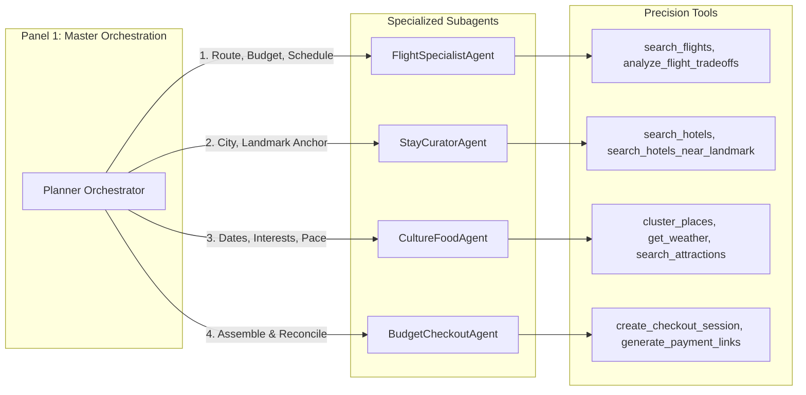
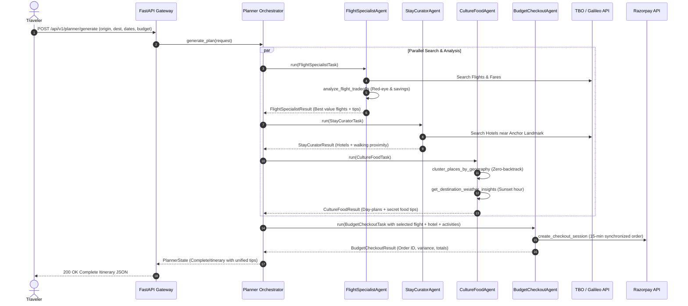
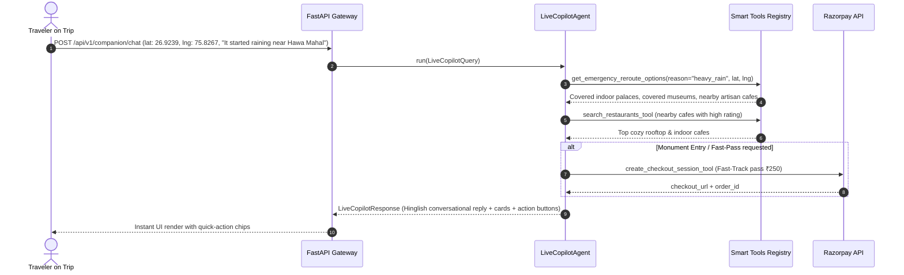
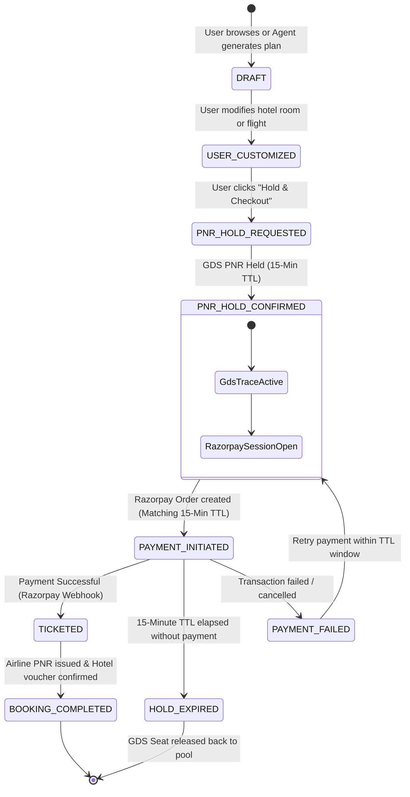

# Plan4U AI Travel Engine & Real-Time Booking Platform — High Level Design (HLD)

---

## 1. Executive Summary & Core Philosophy

**Plan4U** is an enterprise-grade AI travel planning and real-time booking engine architected to eliminate the fragmentation in Indian travel planning. Unlike conventional static planners, Plan4U provides:

1. **Dual Panel Experience:**
   - **Panel 1 (Master Pre-Trip Macro Planner):** End-to-end trip synthesis aggregating Flights, Hotels, Monuments, Dining, and Budget limit with a synchronized 15-minute Razorpay lock.
   - **Panel 2 (Live In-Trip Copilot / Concierge):** Location-aware (live GPS) on-trip companion that handles real-time cravings, sudden weather disruptions (rain/heat pivots), live concerts/events (BookMyShow), and 1-click Fast-Track monument passes.
2. **Hybrid Operational Model:**
   - **Autonomous Multi-Agent Orchestration:** Specialized AI subagents calling typed python tools with precision.
   - **Direct MakeMyTrip-Style Manual Booking & Inventory Exploration:** Full manual control over flights, hotels, dining, and attractions with GPS radius, price band, star ratings, and category filters.
3. **Smart Algorithmic Enhancements:** Zero-backtrack spatial clustering, 2 AM red-eye cab surcharge trade-offs, group expense debt simplifier with NPCI UPI deep-links, and multi-modal transport fare estimators.

---

## 2. High-Level System Architecture

```mermaid
flowchart TD
    subgraph ClientLayer["1. Client Applications"]
        WebClient["Web Application (Next.js / React)"]
        MobileApp["Mobile App (React Native / iOS / Android)"]
    end

    subgraph GatewayLayer["2. Gateway & API Layer"]
        FastAPIGateway["FastAPI Gateway / Router (/api/v1)"]
        AuthMiddleware["CORS, Rate Limiting & Auth"]
    end

    subgraph ServiceLayer["3. Domain Services & Manual MMT Endpoints"]
        FlightService["Flight Service (Search, Quote, Fare Rules, Seat Map, Hold)"]
        HotelService["Hotel Service (Search, Proximity, Details, Pre-Book Lock)"]
        DiningService["Dining Service (Cafes, Restaurants, OSM Client)"]
        AttractionService["Attractions Service (Catalogs, Monuments, GPS Dist)"]
        EventService["Live Events Service (BookMyShow, Insider, Gigs)"]
        GroupSplitService["Group Split Service (Debt Simplifier, NPCI UPI)"]
    end

    subgraph AgentLayer["4. AI Multi-Agent Orchestration Layer"]
        PlannerOrch["Planner Orchestrator (Panel 1 Master)"]
        FlightAgent["FlightSpecialistAgent"]
        StayAgent["StayCuratorAgent"]
        CultureAgent["CultureFoodAgent"]
        BudgetAgent["BudgetCheckoutAgent"]
        CopilotAgent["LiveCopilotAgent (Panel 2 In-Trip)"]
    end

    subgraph SmartToolLayer["5. Algorithmic Intelligence & Smart Tools"]
        SpatialCluster["Zero-Backtrack Spatial Clustering"]
        TradeoffEngine["Flight Deal Hunter & Red-Eye Surcharge Detector"]
        WeatherReroute["Rain & Heat Emergency Rerouting Engine"]
        TransportEstimator["Multi-Modal Fare Estimator (Uber/Ola/Auto/Metro)"]
        EventAnchoredPlanner["Event-Anchored Weekend Planner"]
        PackingEngine["Climate & Activity Packing Checklist"]
    end

    subgraph ExternalProviders["6. External Suppliers & GDS Integrations"]
        TBOGDS["TBO Tek Travels / Galileo uAPI (Flights & Hotels)"]
        OSMGeo["OpenStreetMap / Geoapify (Spatial POI & Lat/Lng)"]
        GeminiAPI["Google Gemini 1.5 Flash (Search Grounding & NLP)"]
        RazorpayGateway["Razorpay Payment Gateway (15-min Lock Orders)"]
    end

    subgraph PersistenceLayer["7. Data & Caching Layer"]
        RedisCache["Redis (Session Cache, 15-min TraceId Holds, Rate Limits)"]
        Database["PostgreSQL (Trips, Bookings, User Preferences, Ledgers)"]
    end

    ClientLayer --> GatewayLayer
    GatewayLayer --> ServiceLayer
    GatewayLayer --> AgentLayer

    AgentLayer --> SmartToolLayer
    AgentLayer --> ServiceLayer

    ServiceLayer --> ExternalProviders
    ServiceLayer --> PersistenceLayer
    SmartToolLayer --> ExternalProviders
```



---

## 3. Layered Architectural Decomposition

### 3.1 Gateway & Routing Layer (`app/api/routes.py`, `app/main.py`)
- **Single Source of Truth:** Manual exploration endpoints and AI agents share identical backend service calls and Pydantic schemas.
- **Master Nearby Explorer (`/api/v1/explore/nearby`):** Aggregates 4 distinct inventory dimensions (Hotels, Dining, Attractions, Live Events) within a customizable radius in a single network round-trip.
- **Panel Endpoints:**
  - `POST /api/v1/planner/generate`: Dispatches to `PlannerOrchestrator`.
  - `POST /api/v1/companion/chat`: Dispatches to `LiveCopilotAgent`.

### 3.2 AI Multi-Agent Orchestration Layer (`app/agent/`)



#### Tool Assignment Matrix:
- **`FlightSpecialistAgent`**: `search_flights`, `quote_flight_fare`, `get_flight_fare_rules`, `get_flight_ssr`, `analyze_flight_tradeoffs`.
- **`StayCuratorAgent`**: `search_hotels`, `search_hotels_near_landmark`, `get_hotel_details`, `prebook_hotel`.
- **`CultureFoodAgent`**: `search_attractions`, `get_attraction_details`, `search_restaurants`, `search_cafes`, `recommend_food_near_stop`, `cluster_places_by_geography`, `get_destination_weather_insights`, `estimate_transport_options`, `generate_packing_checklist`.
- **`BudgetCheckoutAgent`**: `quote_flight_fare`, `prebook_hotel`, `create_checkout_session`, `generate_group_settlement_links`, `convert_currency`.
- **`LiveCopilotAgent` (Panel 2)**: `search_attractions`, `get_attraction_details`, `search_restaurants`, `search_cafes`, `recommend_food_near_stop`, `get_destination_weather_insights`, `estimate_transport_options`, `create_checkout_session`, `get_emergency_reroute_options`, `search_live_events`, `create_event_anchored_plan`.

---

## 4. End-to-End System Workflows

### 4.1 Panel 1: Master Pre-Trip Planner Sequence



---

### 4.2 Panel 2: Live In-Trip Copilot (GPS-Aware Real-Time Pivot)



---

## 5. Booking & Financial State Machine

Both airline GDS (TBO / Galileo) and hotel suppliers enforce strict fare quote expiration policies (~15 minutes). The Plan4U state machine aligns internal reservations with payment gateways and supplier PNR locks.



---

## 6. Algorithmic Intelligence Engines

### 6.1 Zero-Backtrack Spatial Clustering (`app/services/smart_tools/spatial_clustering.py`)
- **Problem:** Conventional LLM planners suggest Amber Fort in the morning, Albert Hall in the afternoon, and Jaigarh in the evening, causing travelers to spend 2+ hours sitting in traffic.
- **Solution:** Computes pairwise Haversine distance matrices and clusters points of interest into geographically dense daily sectors.
- **Impact:** Eliminates crisscrossing, reducing average city transit by 15–90 minutes per day.

### 6.2 Flight Deal Hunter & 2 AM Red-Eye Detector (`app/services/smart_tools/flight_tradeoffs.py`)
- **Problem:** Cheap flights departing at 02:00 AM appear attractive but incur expensive nighttime taxi surcharges (~₹1,500–₹2,000) and disrupt hotel check-in schedules.
- **Solution:** Quantifies true travel cost:
  $$\text{Effective Cost} = \text{Fare} + \text{Airport Taxi Surcharge (if 23:00–05:00)} + \text{Early Check-in Penalty}$$
- **Impact:** Automatically flags hidden expenses and highlights optimal daytime value alternatives.

### 6.3 Group Split & NPCI UPI Deeplink Generator (`app/services/smart_tools/group_payment_links.py`)
- **Problem:** Group travelers struggle to settle shared bills after meals and cab rides.
- **Solution:** Runs greedy min-cash-flow debt simplification to reduce $N$-person debts to minimal transactions, immediately generating clickable NPCI URI deep-links:
  `upi://pay?pa={vpa}&pn={name}&am={amount}&cu=INR&tn={note}`
  paired with WhatsApp pre-filled shareable links.

---

## 7. Non-Functional Requirements & Production Readiness

### 7.1 Scalability & Concurrency
- **Asynchronous Execution:** Async I/O for external supplier APIs (TBO, Galileo, OpenStreetMap). Subagents execute in parallel during plan orchestration to guarantee sub-3 second planning latency.
- **Stateless API Services:** FastAPI application instances can scale horizontally behind an NGINX / Cloudflare load balancer.

### 7.2 Fault Tolerance & Graceful Degradation
- **Supplier Circuit Breakers:** If live GDS endpoints experience latency spikes or rate-limits, requests cleanly fail over to verified cached supplier rates or high-fidelity mock catalogs without taking down the user session.
- **LLM Grounding Fallback:** When Gemini Live Search Grounding quota is reached, subagents gracefully fallback to curated city catalogs (Jaipur, Delhi, Goa) preserving response integrity.

### 7.3 Data Privacy & Compliance
- **Indian Travel Regulations:** PAN card collection for bookings crossing Indian financial thresholds, and GSTIN collection for business travel invoice claims.
- **Payment Security:** PCI-DSS compliance achieved by delegating card data handling entirely to Razorpay checkout SDKs. Sensitive API keys remain server-side in `.env`.

---

## 8. File Structure Mapping

```text
plan4u_backend/
├── app/
│   ├── main.py                          # FastAPI Entrypoint & CORS setup
│   ├── config.py                        # Pydantic Settings & Environment keys
│   ├── api/
│   │   └── routes.py                    # REST Endpoints (Panels, MMT inventory, Tools)
│   ├── agent/
│   │   ├── planner_orchestrator.py      # Panel 1 Master Pre-Trip Orchestrator
│   │   ├── state.py                     # Planner State Model
│   │   └── subagents/                   # Specialized AI Subagents
│   │       ├── flight_agent.py          # Flight Specialist
│   │       ├── stay_agent.py            # Stay Curator
│   │       ├── culture_agent.py         # Culture & Food Guide
│   │       ├── budget_agent.py          # Budget & Checkout Master
│   │       └── copilot_agent.py         # Panel 2 Live City Copilot
│   ├── tools/                           # Unified Tool Registry
│   │   ├── registry.py                  # Agent Tool Map & Dispatcher
│   │   ├── flights.py                   # Flight Tool Implementations
│   │   ├── hotels.py                    # Hotel Tool Implementations
│   │   ├── dining.py                    # Dining & Cafes Tools
│   │   ├── attractions.py               # Monument Tools
│   │   ├── events.py                    # BookMyShow / Live Events Tools
│   │   └── payments.py                  # Razorpay Session Tool
│   ├── services/                        # Domain Services & Smart Engines
│   │   ├── flight_service/              # TBO / Galileo GDS search, quote, hold
│   │   ├── hotel_service/               # TBO Hotel search & room pre-book
│   │   ├── dining_service/              # OSM dining queries & ratings
│   │   ├── attractions_service/         # Curated catalogs & GPS search
│   │   └── smart_tools/                 # Algorithmic Optimization Engines
│   │       ├── spatial_clustering.py    # Zero-backtrack clustering
│   │       ├── flight_tradeoffs.py      # Red-eye & deal hunter engine
│   │       ├── emergency_reroute.py     # Rain & heat reroute engine
│   │       ├── transport_estimator.py   # Cab, Auto, Metro fare calculator
│   │       ├── group_payment_links.py   # UPI deep-links & WhatsApp templates
│   │       └── packing_service.py       # Weather-aware packing checklist
│   └── schemas/                         # Pydantic Request/Response Models
├── docs/
│   └── SYSTEM_HLD.md                    # System High Level Design document
├── tests/
│   └── test_full_suite.py               # 13-Point Automated Regression Suite
├── CURL_API_COLLECTION.md               # Ready-to-run API cURL collection
└── PRODUCTION_CHECKLIST.md              # Live GDS & Razorpay checklist
```
